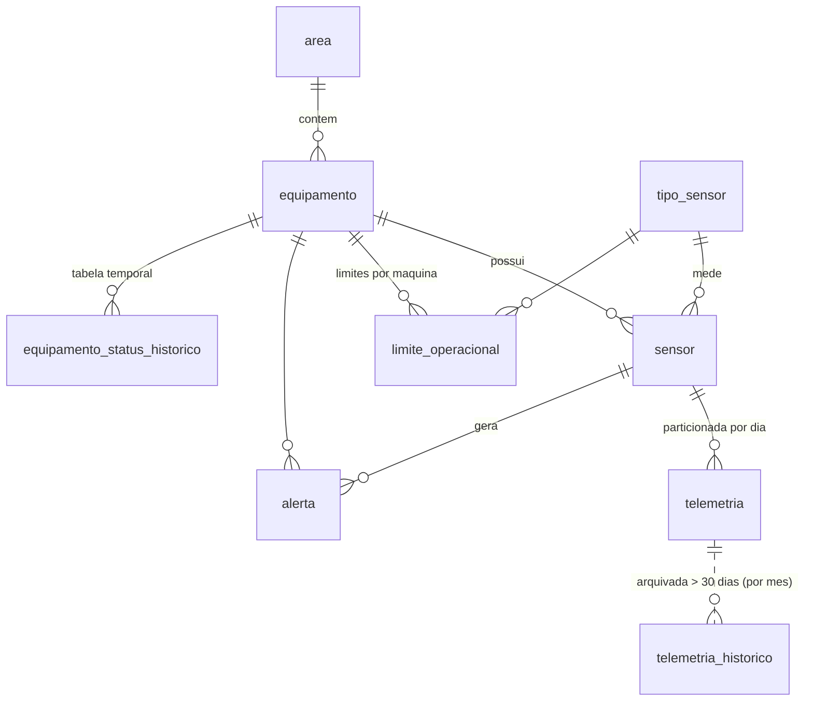

# APS LPBD — Banco de Dados de Alta Performance para Telemetria IoT

Backend de banco de dados de uma **fábrica inteligente simulada**. Ele recebe telemetria contínua de sensores industriais: temperatura e pressão de caldeiras, vibração e corrente de motores, pressão de prensas hidráulicas e velocidade de esteiras.

As decisões críticas ficam **dentro do SGBD**, em PL/pgSQL:

- detectar a falha;
- registrar o alerta;
- mudar o status da máquina;
- arquivar os dados antigos.

**SGBD:** PostgreSQL 14+ (testado no 16 / Ubuntu 24.04).
**Linguagem procedural:** PL/pgSQL.

---

## 1. Requisitos do enunciado × implementação

| Requisito | Onde | Como |
|---|---|---|
| Tabelas de controle de equipamentos e sensores | `01_schema.sql` | `area`, `tipo_sensor`, `equipamento`, `sensor`, `limite_operacional` (limites **por máquina**) |
| Histórico de telemetria com particionamento por data | `01`, `02` | `telemetria` com `PARTITION BY RANGE (lido_em)` e **1 partição por dia**, criadas automaticamente |
| Tabelas temporais | `01`, `03`, `05` | `equipamento_status_historico` com período de validade `tstzrange` e restrição de exclusão GiST. Consultas "AS OF" com `fn_status_em` e disponibilidade com `fn_disponibilidade` |
| Logs de alertas | `01` | `alerta` (com contador de ocorrências e escalada de severidade) e `log_rotina` |
| Trigger de segurança na inserção de telemetria | `03_triggers.sql` | `tg_telemetria_verificar_limites` (AFTER INSERT, por linha). Grava o alerta, muda o status do equipamento e emite `NOTIFY` |
| Procedure simuladora de fluxo | `04_procedures.sql` | `sp_simular_fluxo`: inserção set-based em lotes, com COMMIT por lote e medição de leituras/s |
| Procedure de manutenção (> 30 dias) | `04` | `sp_arquivar_telemetria`: move partições antigas para `telemetria_historico` (particionada por mês) e expurgo opcional |
| Agendamento | `07_agendamentos.sql` | `pg_cron`: manutenção diária às 03:00 e refresh dos relatórios a cada 5 min (com alternativa via crontab) |
| Índices compostos B-Tree/Hash | `01`, `08` | B-Tree `(sensor_id, lido_em)`, BRIN em `lido_em`, comparativo B-Tree × Hash |
| Views materializadas | `05_views.sql` | `mv_resumo_horario` + `vw_relatorio_producao_diario` |
| Testes comparativos de tempo de resposta | `08_benchmark.sql` | `sp_executar_benchmark`: 5 cenários × 5 consultas, com mediana, plano e tamanho dos índices |
| Demonstração com carga massiva simultânea | `demo/` | `pgbench` com N clientes concorrentes + painel ao vivo + escuta de alertas |

---

## 2. Estrutura

```
aps-lpbd-iot/
├── setup.sh                   instala, configura e cria o banco com histórico simulado
├── sql/
│   ├── 01_schema.sql          extensões, tipos, tabelas e índices
│   ├── 02_particionamento.sql criação automática de partições + vw_particoes
│   ├── 03_triggers.sql        trigger de limites + trigger da tabela temporal
│   ├── 04_procedures.sql      simulador, arquivamento, gestão de alertas, rotinas
│   ├── 05_views.sql           view materializada, painéis e consultas temporais
│   ├── 06_seed.sql            16 equipamentos, 37 sensores e limites
│   ├── 07_agendamentos.sql    jobs do pg_cron
│   └── 08_benchmark.sql       benchmark comparativo
└── demo/
    ├── roteiro_demo.sql       roteiro interativo da apresentação (12 etapas)
    ├── carga_concorrente.sh   carga simultânea com pgbench
    ├── pgbench_gateway.sql    transação do pgbench (1 gateway = 1 equipamento)
    ├── painel.sh / painel.sql painel em tempo real (atualiza a cada 1 s)
    └── escutar_alertas.sh     mostra os NOTIFY da trigger em tempo real
```

### Modelo de dados



---

## 3. Instalação (Ubuntu)

```bash
chmod +x setup.sh demo/*.sh
./setup.sh
```

O script executa, em ordem:

1. instala `postgresql`, `postgresql-contrib` e, se existir no repositório, `postgresql-<versão>-cron`;
2. cria `conf.d/90-aps-lpbd.conf` com fuso `America/Sao_Paulo`, WAL maior para carga em massa e configuração do pg_cron;
3. cria um usuário do banco com o seu usuário Linux, para você conectar só com `psql fabrica_iot`;
4. cria o banco e roda os scripts `sql/01` a `sql/08`;
5. gera **2 milhões de leituras** distribuídas nos últimos **45 dias**, para ter dados acima de 30 dias para o arquivamento.

Opções:

```bash
./setup.sh --recriar                  # apaga e recria o banco
./setup.sh --sem-instalar --recriar   # só recria o banco (sem apt)
./setup.sh --leituras 10000000        # histórico maior para o benchmark
./setup.sh --dias 60
```

> Na carga inicial as triggers ficam desligadas (`session_replication_role = replica`), como numa importação de histórico. Todas as inserções depois disso passam pelas triggers.

---

## 4. Uso rápido

```sql
-- 300 mil leituras em tempo real, 0,01% críticas (+0,01% em atenção)
CALL fabrica.sp_simular_fluxo(300000, 0.01);

-- Histórico de 7 dias sem triggers (importação)
CALL fabrica.sp_simular_fluxo(1000000, 0.2, now() - interval '7 days', now(), 100000, false);

SELECT * FROM fabrica.vw_painel_equipamentos;
SELECT * FROM fabrica.vw_alertas_ativos;

CALL fabrica.sp_reconhecer_alerta(12, 'joao');
CALL fabrica.sp_resolver_alerta(12, 'joao', 'Rolamento trocado');
CALL fabrica.sp_resolver_alerta();                       -- resolve todos
CALL fabrica.sp_definir_status_manual('PRE-02', 'MANUTENCAO', 'Troca de vedação');

CALL fabrica.sp_arquivar_telemetria(30);                 -- data lifecycle
CALL fabrica.sp_arquivar_telemetria(30, 12);             -- + expurga histórico > 12 meses

CALL fabrica.sp_atualizar_relatorios();
SELECT * FROM fabrica.vw_relatorio_producao_diario ORDER BY dia DESC;

SELECT * FROM fabrica.vw_disponibilidade_24h;                    -- tabela temporal
SELECT * FROM fabrica.fn_status_em(now() - interval '10 minutes'); -- "viagem no tempo"

SELECT * FROM fabrica.vw_particoes;
SELECT * FROM fabrica.log_rotina ORDER BY id DESC;
```

---

## 5. Demonstração (dia da apresentação)

Abra 4 terminais:

| Terminal | Comando | Mostra |
|---|---|---|
| 1 | `./demo/painel.sh` | status das máquinas, alertas e leituras/s atualizando a cada segundo |
| 2 | `./demo/escutar_alertas.sh` | notificações da trigger chegando em tempo real (`LISTEN/NOTIFY`) |
| 3 | `psql fabrica_iot -f demo/roteiro_demo.sql` | roteiro guiado com pausas: trigger, escalada, tabela temporal, manutenção, simulador, arquivamento, relatórios e benchmark |
| 4 | `./demo/carga_concorrente.sh 16 60 0.02` | 16 clientes simultâneos por 60 s (rodar quando o roteiro pedir, na etapa 7) |

`carga_concorrente.sh` aceita `[clientes] [segundos] [% críticas]`. Cada transação simula o gateway de um equipamento enviando todos os seus sensores de uma vez.

> A etapa 9 do roteiro arquiva os dados com mais de 30 dias. Para ensaiar de novo do zero: `./setup.sh --sem-instalar --recriar`.

---

## 6. Agendamento

**Com pg_cron** (configurado pelo `setup.sh`):

| Job | Quando | O que faz |
|---|---|---|
| `fabrica-manutencao-diaria` | 03:00 | cria as partições dos próximos 7 dias, arquiva > 30 dias e atualiza relatórios |
| `fabrica-refresh-relatorios` | a cada 5 min | `REFRESH MATERIALIZED VIEW CONCURRENTLY` |

```sql
SELECT jobname, schedule, command FROM cron.job;
SELECT * FROM cron.job_run_details ORDER BY start_time DESC LIMIT 10;
```

**Sem pg_cron**, use o cron do Linux (`crontab -e`):

```
0 3 * * *   psql -X -q -d fabrica_iot -c "CALL fabrica.sp_manutencao_diaria(30)"  >> $HOME/aps-lpbd-cron.log 2>&1
*/5 * * * * psql -X -q -d fabrica_iot -c "CALL fabrica.sp_atualizar_relatorios()" >> $HOME/aps-lpbd-cron.log 2>&1
```

---

## 7. Benchmark

```sql
CALL fabrica.sp_executar_benchmark(5);
SELECT * FROM fabrica.vw_benchmark_comparativo;   -- mediana, ganho vs. linha de base e plano
SELECT * FROM fabrica.vw_benchmark_indices;       -- tamanho e tempo de criação dos índices
```

Cada consulta roda uma vez para aquecer o cache e depois N vezes com `EXPLAIN (ANALYZE, TIMING OFF)`. O JIT fica desligado durante o teste. Os planos completos ficam em `benchmark_resultado.plano` (JSON).

**Resultados de referência** (ambiente de teste, ~1,64 milhão de linhas operacionais, mediana de 5 execuções). Os números da sua máquina vão ser diferentes; o que importa para o relatório é a proporção entre os cenários.

| Consulta | A) sem índice | B) B-Tree | C) Hash | D) Particionada | E) View mat. |
|---|---|---|---|---|---|
| Q1 Relatório horário (1 dia) | 87,2 ms | 28,0 ms | — | 25,9 ms | **0,65 ms** |
| Q2 Últimas 100 leituras do sensor | 104,7 ms | **0,022 ms** | — | 0,206 ms | — |
| Q3 Sensor em janela de 1 h | 72,4 ms | 0,207 ms | — | **0,023 ms** | — |
| Q4 `id = x` | 75,3 ms | 0,003 ms | 0,003 ms | 0,118 ms | — |
| Q5 `id BETWEEN` | 66,7 ms | **0,155 ms** | 79,6 ms (seq scan) | 0,208 ms | — |

**Vazão de escrita medida:**

| Cenário | Vazão |
|---|---|
| Sem triggers | ~63 mil leituras/s |
| Com triggers | ~26 mil leituras/s |
| 16 clientes concorrentes, 1 commit por transação | ~2.100 transações/s, sem falhas nem deadlocks |

**Pontos para discutir no relatório:**

- **Particionamento + pruning:** em consultas com filtro de tempo (Q1, Q3), o plano lê **1 de ~39 partições**. A coluna `nos_plano` mostra "partições lidas: 1 de N".
- **Custo da partição:** sem filtro de tempo (Q2, Q4, Q5), a consulta percorre todas as partições, e por isso a tabela única com B-Tree vence ali. É o motivo de os relatórios sempre filtrarem por período.
- **Hash × B-Tree:** empatam na igualdade (Q4). O Hash não serve para faixa (Q5 cai em seq scan) e ficou maior e mais lento para criar. Para chaves inteiras, B-Tree é a escolha mais versátil.
- **View materializada:** dá o maior ganho no relatório agregado (~130×), ao custo de dados defasados até o próximo refresh (5 min).
- **BRIN** em `lido_em`: menos de 1 MB contra dezenas de MB de um B-Tree, porque a telemetria chega em ordem temporal.
- **Custo das triggers:** a regra de segurança por linha reduz a vazão de escrita em ~2,5×. É o preço da decisão em tempo real dentro do banco.

---

## 8. Decisões de projeto

- **Partição diária:** cada partição tem poucos MB, o pruning é eficiente e o arquivamento remove partições inteiras.
- **Arquivamento por partição** (`INSERT ... SELECT` + `DROP TABLE`) em vez de `DELETE` linha a linha: não gera bloat nem exige VACUUM na tabela operacional. Cada partição tem seu próprio COMMIT para o bloqueio na tabela pai durar milissegundos. Linhas antigas que caíram na partição DEFAULT são movidas com `DELETE ... RETURNING`.
- **Um alerta aberto por sensor:** índice único parcial `WHERE situacao <> 'RESOLVIDO'` + `INSERT ... ON CONFLICT DO UPDATE`. Isso é atômico mesmo com inserções concorrentes e evita milhares de alertas repetidos durante uma rajada. Cada violação incrementa `ocorrencias` e pode escalar ATENÇÃO para CRÍTICO.
- **Status só piora pela trigger** (enum ordenado OPERANDO < ATENCAO < FALHA). Ela nunca sobrescreve MANUTENCAO/DESLIGADO, e o UPDATE só toca a linha do equipamento quando o status muda de fato, o que reduz a disputa de bloqueio.
- **NOTIFY só em eventos relevantes** (alerta novo ou mudança de status), para não inundar o canal.
- **Tabela temporal com `tstzrange` + `EXCLUDE USING gist`:** o banco garante que um equipamento nunca tem dois status ao mesmo tempo.
- **Partição DEFAULT** como rede de segurança: `fn_criar_particao_dia` move as linhas dela quando a partição do dia é criada depois.

---

## 9. Problemas comuns

| Problema | Solução |
|---|---|
| `role "<usuario>" does not exist` | rode `./setup.sh` sem `--sem-instalar` (ele cria o usuário) |
| `pg_cron indisponível` | use o crontab (seção 6). Em versões do Ubuntu sem o pacote, dá para instalar pelo repositório oficial `apt.postgresql.org` |
| `permission denied to set parameter "session_replication_role"` | a carga sem triggers exige superusuário; use `p_disparar_triggers => true` |
| `invalid transaction termination` ao chamar procedure | não chame `sp_simular_fluxo`/`sp_arquivar_telemetria` dentro de `BEGIN ... COMMIT` (elas controlam a própria transação) |
| Painel sem `watch` | `sudo apt install procps` |
